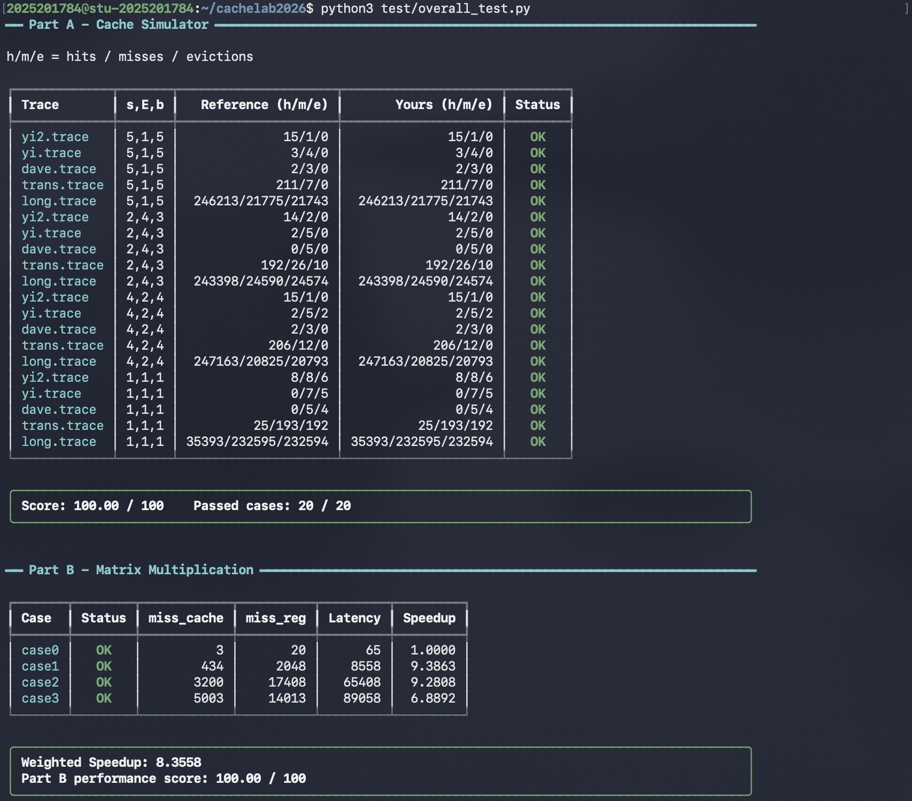
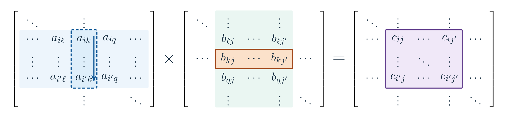
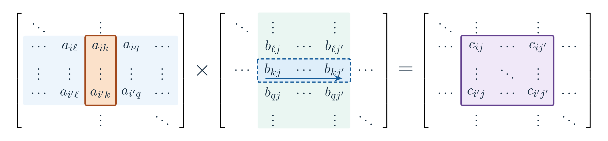

# CacheLab 报告

姓名：xxx

学号：2025200000

| csim 分数（/100） | case1 speedup | case2 speedup | case3 speedup | weighted speedup | Part B 性能分（/100） |
| ---------------- | ------------- | ------------- | ------------- | ---------------- | ------------------- |
| 100.00 | 9.39 | 9.28 | 6.89 | 8.36 | 100.00 |

本地评测截图：



## Part A: cache 模拟器

### 实现简述

一路（一块）用自定义结构体

```c
typedef struct
{
  uint64_t tag;
  uint64_t last_used;
} CacheLine;
```

模拟。分配一块大小为模拟整个缓存所需的字节数的内存

```c
CacheLine *cache = calloc(set_count * ways, sizeof(*cache));
```

并在其中按照类似多维数组线性存储的方式排列所有模拟路。

对于从 trace 文件读入的每条合法访存请求，（由于采用写分配并且不要求记录脏标记，无论请求是读还是写，在缓存层面的行为是一样的），用函数

```c
static AccessResult access_set(CacheLine *set, size_t ways, uint64_t need_tag, uint64_t timestamp)
{
  CacheLine *victim = set;
  for (size_t way = 0; way < ways; ++way)
  {
    CacheLine *line = &set[way];
    if (line->last_used && line->tag == need_tag)
    {
      line->last_used = timestamp;
      return HIT;
    }
    if (line->last_used < victim->last_used)
      victim = line;
  }

  AccessResult result = victim->last_used ? MISS_AND_EVICT : MISS;
  *victim = (CacheLine){need_tag, timestamp};
  return result;
}
```

维护模拟缓存并返回访问结果（是否命中，是否发生驱逐）。具体而言，函数在模拟缓存的指定组范围内，遍历每个模拟路检查是否命中，并同时逐步将候选牺牲路更新为上次使用离本次请求最远的路，如果不命中则驱逐并替换。

### 亮点

- 采用 UNIX 风格的命令行参数解析和错误处理
- 用 `SCNx64` `PRIx64` 宏使负责读入或打印 `uint64_t` 类型的代码具有跨平台稳定性。

## Part B: 矩阵乘法优化

### 亮点

- 一个 $C$ 矩阵元只写入一次
- 尽量沿行方向访问，尽量存入寄存器
- 需要沿列方向访问的，尽量保留其缓存，以便改变列号时复用缓存
- 寄存器不足以容纳的，也尽量保留其缓存

#### 我认为的最优秀的实现排序

1. case2
2. case1
3. case3

### case1

|miss_cache|miss_reg|
|-|-|
| 434         | 2048       |

除开对 $A,B$ 的读，写 $C$，尤其是缓存不命中地写 $C$，显然是最耗时的，所以要么尽量写缓存命中，要么不要多次写。尽管题目采用写回策略，考虑到缓存只能容纳 $32\times 4$ 个 `int`、参与乘法的矩阵一个就有 $16^2$ 个 `int`，保障 $A,B$ 在缓存内的周转应该优先，所以不用考虑让未完成计算的 $C$ 矩阵元在缓存中多停留，而应该考虑让 $C$ 矩阵元直接在寄存器中完成计算、一次写回内存。

为了充分利用 $C$ 矩阵元占据的缓存块，减少无效写出，应该尽量让一路缓存内的四个矩阵元都获得计算结果。$36$ 个寄存器，去掉四个传入参数、至少两个用来表示 $C$ 下标（或等价形式）的迭代变量、至少两个用来读入 $A,B$ 的临时变量，还剩 $28$ 个。事实上，应该同时读入多个（4个） $B$ 元素，所以最多一次计算完并写出 $24$ 个 $C$ 矩阵元。确定 $C$ 分为 $6\times 4$ 的块后，再用一个寄存器跟踪块号，正好用完。

计算时，

1. 如图中紫色框所示，按行优先方式确认一个 $C$ 分块（行：$i$ 到 $i'$，列：$j$ 到 $j'$），创建寄存器数组；
2. 如图中棕色框所示，对 $B$ 的 $k$ 行，取出行内对该块负责的列（$j$ 到 $j'$）；
3. 如图中蓝色框所示，对 $A$ 的 $i$ 到 $i'$ 每一行，取出给 $B_k$ 行加权的第 $k$ 元素，乘以取出的 $B_k$ 行切片，更新到 $C$ 块数组中，完成 $A$ 的一行就获得了 $C$ 块的一行。

寄存器 miss 精确等于所有元素总读/写次数，其中 $A$ 每个元素在 $C$ 块换列时被重复读，$B$ 每个元素在 $C$ 块换行时被重复读，所以总共 $16\times 16\times 4 + 16\times 16\times 3+ 16\times 16 \times 1=2048$。
当前缓存不能全部容纳计算一个 $C$ 块所需的 $6\times 16+16\times 4$ 个元素。假如可以，并不考虑不同 $C$ 块之间的影响，期待 miss $(6\times 4+4\times 4)\times 8+(4\times 4+4\times 4)\times 4+8\times 6 +4\times 4=512$，缓存复用收益比缓存冲突损失大，导致实际值较小。



### case2

|miss_cache|miss_reg|
|-|-|
|3200|17408|

采用 $4\times 4$ 对 $C$ 分块计算策略，计算时，

1. 如图中紫色框所示，按行优先方式确认一个 $C$ 分块（行：$i$ 到 $i'$，列：$j$ 到 $j'$），创建寄存器数组；
2. 如图中棕色框所示，对 $A$ 的 $k$ 列，取出列内对该块负责的行（$i$ 到 $i'$）；
3. 如图中蓝色框所示，对 $B$ 的 $j$ 到 $j'$ 每一列，取出给 $A^k$ 列加权的第 $k$ 元素，将加权后的 $A^k$ 列切片加入 $C$ 的第 $j$ 到 $j'$ 列；
4. 遍历完 $A$ 的全部列获得完整 $C$ 块。

注意此处 $B$ 单个搬入但是后续搬入能命中缓存，$A$ 虽然沿着列方向批量搬入但是后续搬入命中同行缓存。原则上可以使用和 case1 一样的方法，但是因为对称性和正好能填满缓存，实际并无影响；case3 也将使用这一方法，但是是出于确实的原因。

用同样方法可以精确计算寄存器 miss。

可以分出 $64$ 个一样尺寸的 $C$ 块，用同样方法估计缓存 miss $64\times (4\times 8 + 32\times 1) + 64\times 4\times 1=4352$。和 case1 同样原因导致估计偏大。



### case3

miss_cache|miss_reg|
|-|-|
|5003|14013|

计算过程和 case2 相同，除了边界不对齐导致额外的判定，以及 $C$ 分块为 $4\times 6$。此时不能采用 case1 的做法，因为寄存器数量不够存 $6$ 个临时读入数字。同样方法估计缓存 miss 为 $4690$，较实际值小，因为边界不对齐产生的缓存利用不充分加剧了缓存冲突，使得可能的缓存复用效果相对变弱。

## 反馈/收获/感悟/总结

<!-- 这一节，你可以简单描述你在这个 lab 上花费的时间/你认为的难度/你认为不合理的地方/你认为有趣的地方 -->

<!-- 或者是收获/感悟/总结 -->

<!-- 我们会认真听取大家的建议～ -->

## 参考的重要资料

<!-- 有哪些文章/论文/PPT/课本对你的实现有重要启发或者帮助，或者是你直接引用了某个方法 -->

<!-- 请附上文章标题或概述和可访问的网页路径 -->

<!-- 不列出参考了的参考资料会被认为是学术不端 -->
